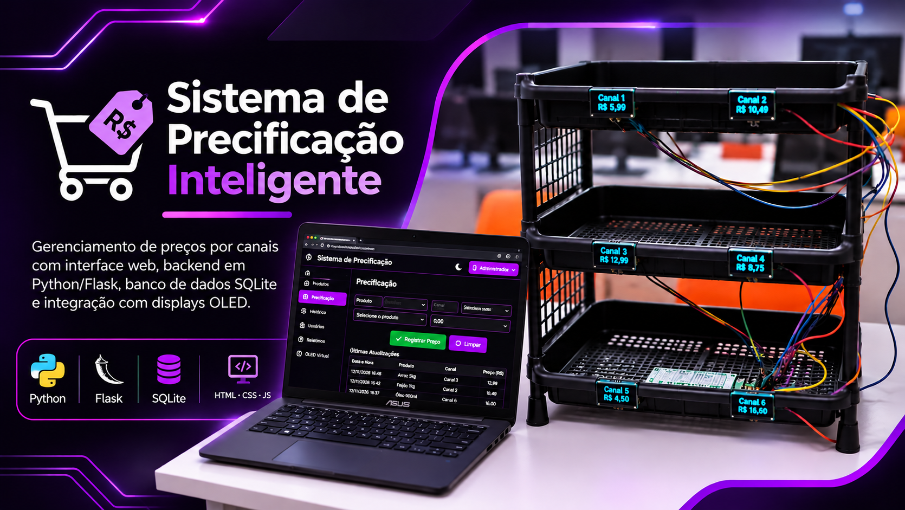
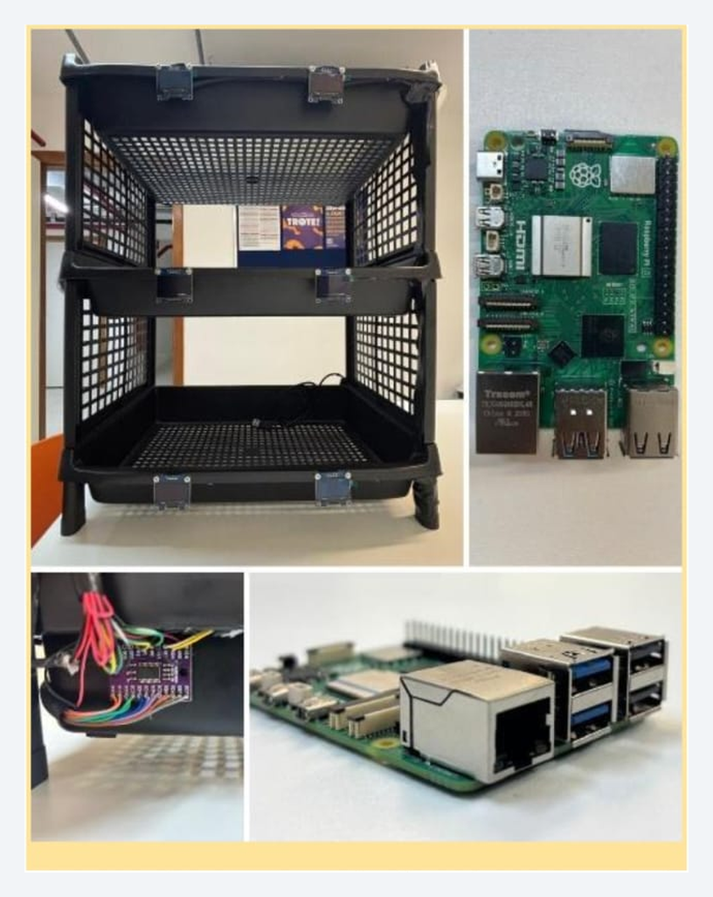
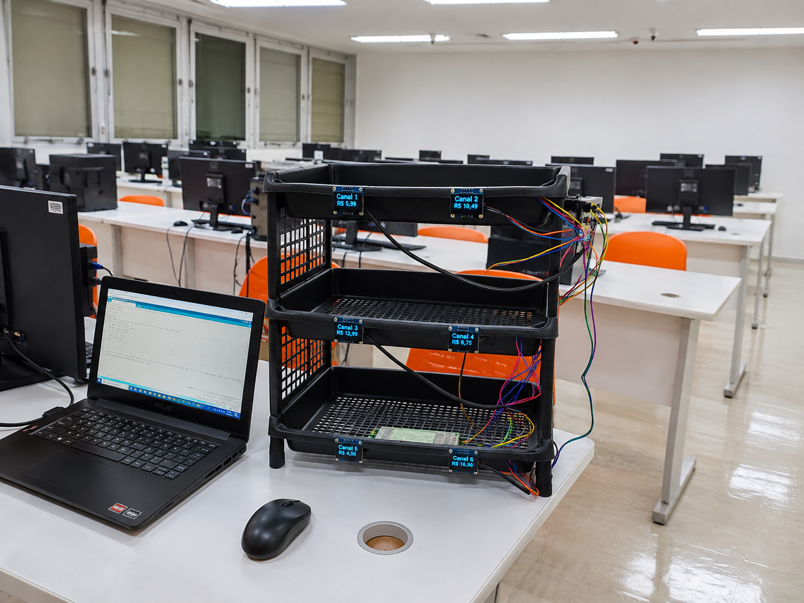
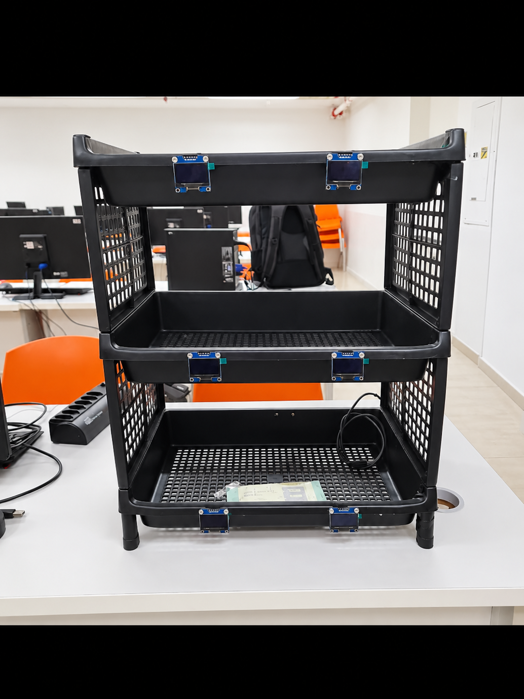
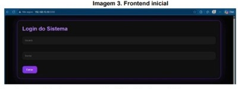
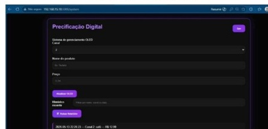
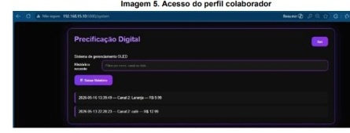

# Sistema de Precificação Inteligente

Sistema de gerenciamento de preços por canais, com interface web, backend em Python/Flask, banco de dados SQLite e integração com displays OLED. O projeto foi desenvolvido para demonstrar a atualização de preços em uma estrutura de exposição de produtos, com possibilidade de expansão para comunicação remota e aplicativo móvel.


## Visão geral

A aplicação permite registrar o produto e o preço associado a um canal, consultar o histórico de atualizações e apresentar as informações nos displays OLED. Também possui autenticação de usuários e perfis de acesso, além de recursos de geração de relatórios.

## Funcionalidades

- Cadastro e atualização de produtos e preços por canal.
- Histórico de solicitações e alterações de preços.
- Interface web com modo claro e modo escuro.
- Tela OLED virtual com atualização automática e seleção de canal.
- Integração com displays OLED físicos por meio de multiplexador I2C.
- Autenticação e gerenciamento de usuários com perfis de acesso.
- Geração e exportação de relatórios em Excel.
- Modo simulado para desenvolvimento e testes sem o hardware conectado.

## Tecnologias e componentes

**Software**

- Python
- Flask
- SQLite
- HTML5, CSS3 e JavaScript
- Pandas

**Hardware**

- Displays OLED SSD1306
- Multiplexador I2C TCA9548A/PCA9548A
- Microcontrolador Arduino (na montagem apresentada no projeto)
- Raspberry Pi (na evolução/estrutura de hardware documentada)
- Estrutura física de prateleiras, cabeamento e fonte de alimentação

## Estrutura do projeto

```text
projeto_oled/
├── backend/
│   ├── app.py
│   ├── auth.py
│   ├── create_admin.py
│   ├── database.py
│   ├── oled_display.py
│   ├── precificacao.py
│   └── relatorio.py
├── frontend/
│   ├── login.html
│   ├── login.js
│   ├── index.html
│   ├── script.js
│   ├── display.html
│   ├── display.js
│   ├── style.css
│   └── theme.js
├── docs/
│   └── imagens/
├── .env.example
├── .gitignore
├── README.md
└── requirements.txt
```

## Demonstração do hardware

As imagens abaixo registram a estrutura física, os displays OLED e a montagem dos componentes utilizados nos testes.

### Estrutura e displays OLED



*Estrutura de exposição com displays OLED instalados nas prateleiras.*

### Montagem e cabeamento



*Detalhes da montagem eletrônica, conexões e componentes do sistema.*

### Vista frontal do protótipo



*Vista frontal do protótipo físico com os displays posicionados na estrutura.*

## Interfaces do sistema

### Tela de login



*Interface de autenticação para acesso ao sistema.*

### Registro e gerenciamento — perfil administrador



*Interface de registro de preços e gerenciamento de usuários no perfil administrador.*

### Histórico — perfil colaborador



*Visualização do histórico disponível no perfil colaborador.*

## Instalação e configuração

### 1. Instalar as dependências

Na pasta raiz do projeto, execute:

```bash
pip install -r requirements.txt
```

### 2. Configurar a chave secreta do Flask

Crie uma cópia do arquivo `.env.example` com o nome `.env`. Gere uma chave exclusiva com:

```bash
python -c "import secrets; print(secrets.token_hex(32))"
```

Insira o valor gerado no arquivo `.env`:

```env
FLASK_SECRET_KEY=sua_chave_secreta_aqui
```

**Importante:** não publique nem compartilhe o arquivo `.env`. Ele deve permanecer listado no `.gitignore`.

### 3. Criar o primeiro administrador

Em uma instalação nova, execute:

```bash
python backend/create_admin.py
```

Siga as instruções no terminal para cadastrar o usuário administrador e uma senha forte.

### 4. Executar a aplicação

Na pasta raiz do projeto, execute:

```bash
python backend/app.py
```

Acesse pelo navegador:

- Login: `http://localhost:5000`
- Sistema: `http://localhost:5000/system`
- OLED virtual: `http://localhost:5000/display`

Para acessar pelo celular na mesma rede Wi-Fi, utilize o endereço IP local do computador no lugar de `localhost`. O servidor precisa estar em execução e configurado para aceitar conexões na rede.

## Segurança e arquivos locais

- Não publique arquivos `.env`, senhas ou chaves de acesso.
- Não inclua bancos de dados locais com dados privados ou reais.
- Ambientes virtuais, arquivos temporários e relatórios gerados devem permanecer fora do repositório.
- Em uma instalação nova, crie credenciais próprias; não utilize senhas padrão.
- Antes de disponibilizar o sistema pela internet, implemente e revise as configurações de segurança e hospedagem.

## Desenvolvimento futuro

O projeto está em desenvolvimento contínuo. Entre as possibilidades de evolução estão um aplicativo móvel em Flutter e a comunicação remota com dispositivos Raspberry Pi, mantendo a integração com os displays OLED.